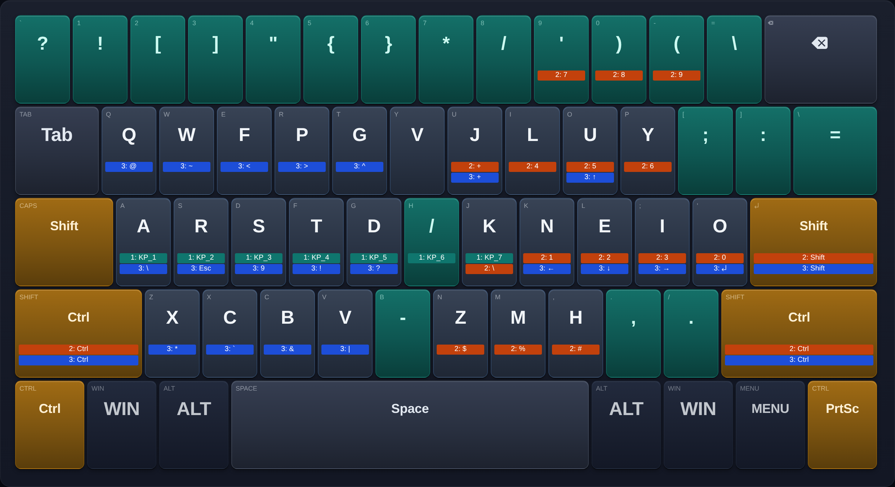
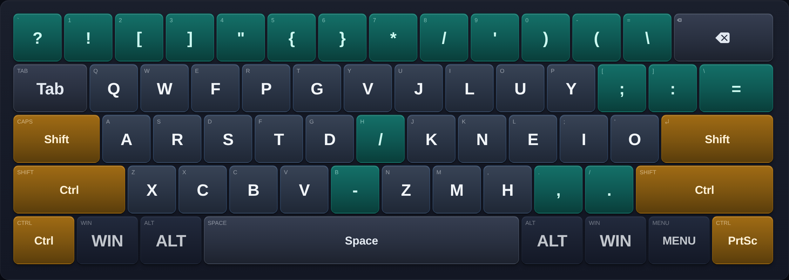
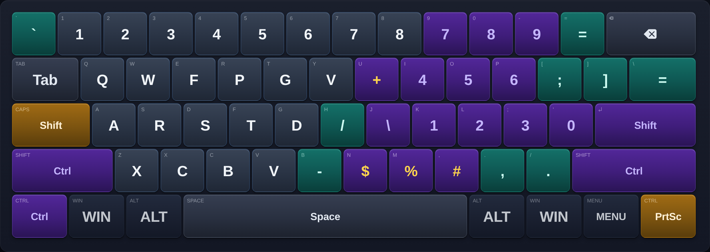
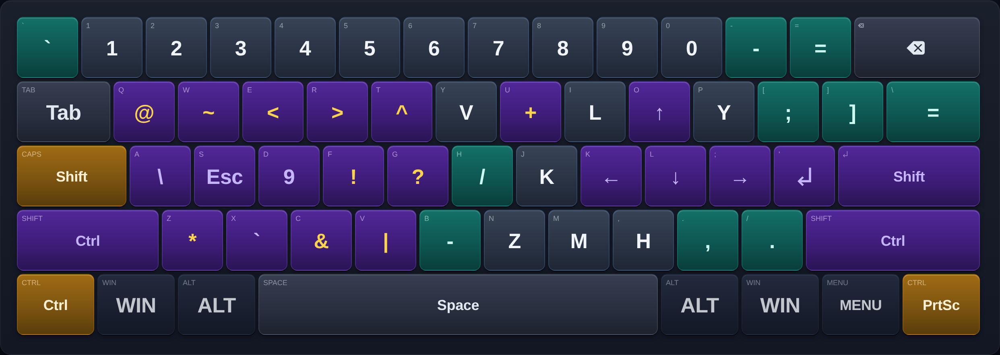

# Eduuh-DH keyboard layout

Eduuh-DH is a Colemak-inspired layout for Keyflow. It puts common letters on the home row, programming symbols on the number row, and extra keys on the Left Alt and Right Alt layers.

## Base layout

| Physical key | Base output | Physical key | Base output |
|--------------|-------------|--------------|-------------|
| Q | Q | Y | V |
| W | W | U | J |
| E | F | I | L |
| R | P | O | U |
| T | G | P | Y |
| A | A | H | `/` |
| S | R | J | K |
| D | S | K | N |
| F | T | L | E |
| G | D | `;` | I |
| | | `'` | O |
| Z | X | N | Z |
| X | C | M | M |
| C | B | `,` | H |
| V | V | `.` | `,` |
| B | `-` | `/` | `.` |

## Modifier keys

| Physical key | Keyflow output |
|--------------|----------------|
| Caps Lock | Left Shift |
| Left Shift | Left Ctrl |
| Right Shift | Right Ctrl |
| Enter | Right Shift |
| Right Ctrl | Print Screen |
| Left Windows | Left Alt |

Caps Lock no longer toggles Caps Lock. Left and right Shift act as Ctrl when used with shortcuts.

On Linux, physical Left Ctrl acts as Left Alt; the Shift-to-Ctrl mappings remain unchanged. Left Windows passes through as Super. It can open the app launcher and control workspaces and windows.

## Number row

Without Shift, the number row produces programming symbols:

| Key | Output | Key | Output |
|-----|--------|-----|--------|
| `` ` `` | `?` | 7 | `*` |
| 1 | `!` | 8 | `/` |
| 2 | `[` | 9 | `'` |
| 3 | `]` | 0 | `)` |
| 4 | `"` | `=` | `+` |
| 5 | `{` | `]` | `:` |
| 6 | `}` | Tab | Tab |

Hold Shift to use the normal number or symbol.

## Left Alt: numpad

Hold Left Alt. The right side becomes a numpad:

| Physical keys | Output |
|---------------|--------|
| I O P | 4 5 6 |
| K L `;` `'` | 1 2 3 0 |
| 9 0 `-` | 7 8 9 |
| J | `\` |

Left Alt also provides these symbols:

| Keys | Output |
|------|--------|
| Left Alt + N | `$` |
| Left Alt + M | `%` |
| Left Alt + `,` | `#` |
| Left Alt + U | `+` |

## Right Alt: arrows and symbols

Hold Right Alt for arrows and programming symbols:

| Keys | Output |
|------|--------|
| Right Alt + K | Left |
| Right Alt + L | Down |
| Right Alt + O | Up |
| Right Alt + `;` | Right |
| Right Alt + `'` | Enter |
| Right Alt + A | `\` |
| Right Alt + S | Escape |
| Right Alt + D | `9` |
| Right Alt + X | `` ` `` |

Right Alt with these keys produces symbols:

| Keys | Output |
|------|--------|
| Right Alt + E | `<` |
| Right Alt + R | `>` |
| Right Alt + U | `+` |
| Right Alt + Q | `@` |
| Right Alt + W | `~` |
| Right Alt + T | `^` |
| Right Alt + F | `!` |
| Right Alt + G | `?` |
| Right Alt + Z | `*` |
| Right Alt + C | `&` |
| Right Alt + V | `\|` |

## Test the layout

`tests/unit/integration/test_config_coverage.cpp` checks every mapping in `src/config.json`.
